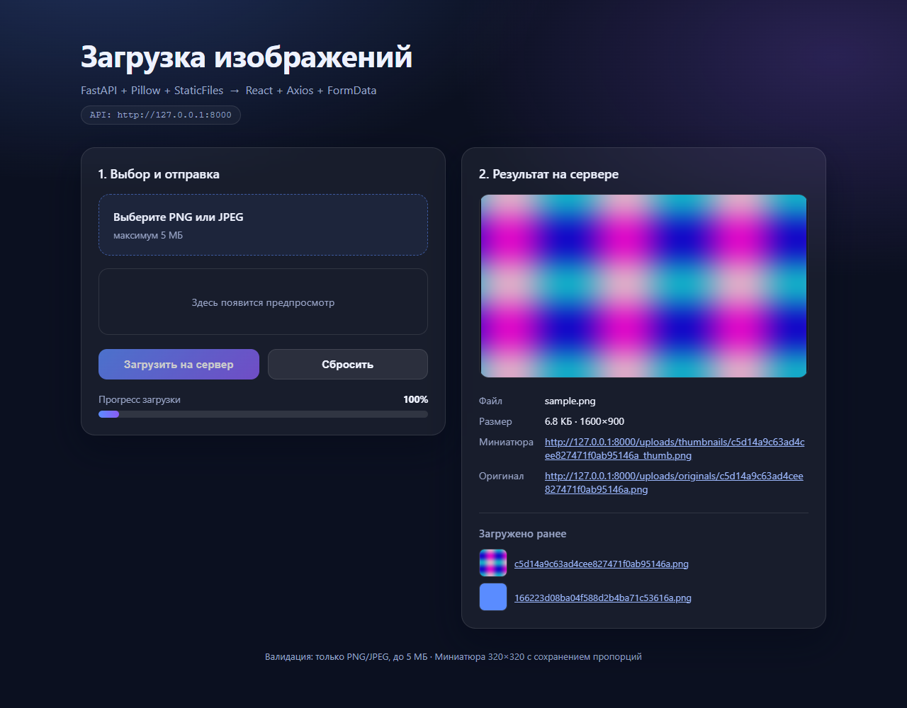
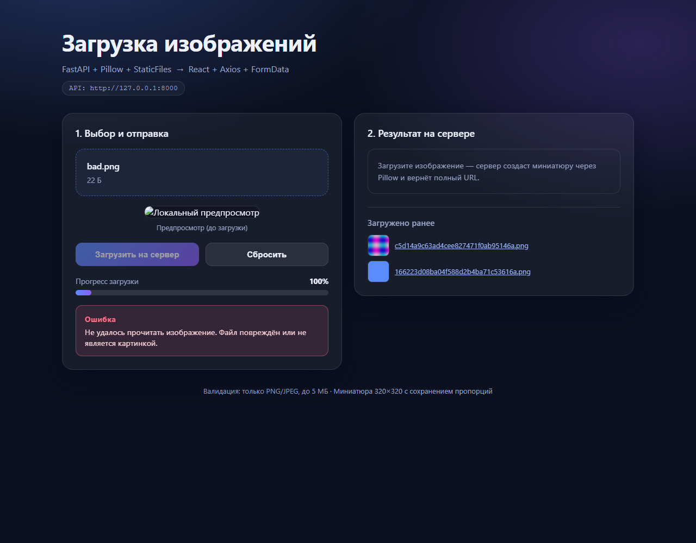

# Практическое задание 3.3 — отдача файлов клиенту и отображение в React

Полный цикл загрузки изображения: выбор файла в React с предпросмотром → отправка на
FastAPI-сервер → валидация → создание миниатюры через Pillow → раздача файлов через
`StaticFiles` → отображение миниатюры в React.

**Стек:** FastAPI, Pillow, StaticFiles, React, Axios, FormData.



## Возможности

- Загрузка изображения через `UploadFile` с проверкой MIME-типа (`image/png`,
  `image/jpeg`), размера (≤ 5 МБ) и целостности картинки; при нарушении — понятная
  ошибка `400`.
- Автоматическая миниатюра 320×320 через Pillow с сохранением пропорций, отдельно от
  оригинала.
- Раздача папки `uploads/` через `StaticFiles`: `/uploads/originals/...` и
  `/uploads/thumbnails/...`.
- Ответ сервера содержит **полные** URL (`http://...`), а не относительные пути.
- React: предпросмотр выбранного файла через `URL.createObjectURL` до отправки,
  отправка через `FormData` + Axios с прогрессом (`onUploadProgress`), отображение
  миниатюры от сервера, обработка ошибок сервера и сети без падения приложения.
- Клиентская проверка формата и размера выполняется до запроса на сервер.

## Структура

```
pythonreactkt03/
├── backend/
│   ├── main.py            # FastAPI: /api/upload, /api/images, /uploads (StaticFiles)
│   ├── requirements.txt
│   ├── smoke_test.py      # проверка API через HTTP (запуск при работающем сервере)
│   └── uploads/           # создаётся автоматически
│       ├── originals/
│       └── thumbnails/
├── frontend/
│   ├── src/App.jsx        # форма загрузки, предпросмотр, прогресс, результат
│   ├── src/api.js         # Axios-клиент, валидация файла, разбор ошибок
│   ├── src/styles.css
│   ├── .env.example       # VITE_API_URL
│   └── vite.config.js
└── docs/                  # скриншоты интерфейса
```

## Запуск

### 1. Backend (терминал №1)

```bash
cd backend
python -m venv .venv
# Windows: .venv\Scripts\activate
# Linux/macOS: source .venv/bin/activate
pip install -r requirements.txt
uvicorn main:app --reload --host 127.0.0.1 --port 8000
```

- API: <http://127.0.0.1:8000>
- Swagger: <http://127.0.0.1:8000/docs>
- Статика: <http://127.0.0.1:8000/uploads/thumbnails/…>

### 2. Frontend (терминал №2)

```bash
cd frontend
npm install
npm run dev
```

Откройте <http://localhost:5173>. При необходимости адрес API меняется в
`frontend/.env` (см. `.env.example`).

> CORS на backend уже разрешён для `http://localhost:5173` и `http://127.0.0.1:5173`.

## API

### `POST /api/upload`

`multipart/form-data`, поле `file`.

Пример ответа `200`:

```json
{
  "id": "c5d14a9c63ad4cee827471f0ab95146a",
  "filename": "sample.png",
  "size": 6900,
  "width": 1600,
  "height": 900,
  "original_url": "http://127.0.0.1:8000/uploads/originals/c5d14a9c63ad4cee827471f0ab95146a.png",
  "thumbnail_url": "http://127.0.0.1:8000/uploads/thumbnails/c5d14a9c63ad4cee827471f0ab95146a_thumb.png"
}
```

Ошибки `400`:

| Причина | Сообщение |
| --- | --- |
| не PNG/JPEG | `Неподдерживаемый формат файла. Разрешены только PNG и JPEG.` |
| больше 5 МБ | `Файл слишком большой: 6.03 МБ. Максимальный размер — 5 МБ.` |
| повреждённый файл | `Не удалось прочитать изображение. Файл повреждён или не является картинкой.` |

### `GET /api/images`

Список ранее загруженных изображений с полными URL (используется для блока «Загружено
ранее»).

### `GET /api/health`

Проверка доступности сервера.

## Проверка

```bash
cd backend
python smoke_test.py   # при запущенном uvicorn
```

Скрипт проверяет успешную загрузку, полные URL, доступность файлов по `StaticFiles`,
сохранение пропорций миниатюры и ошибки `400` для неверного типа, размера и
повреждённого изображения.

## Скриншоты

| Успешная загрузка | Ошибка сервера |
| --- | --- |
|  |  |

## Переменные окружения

| Переменная | Где | Назначение |
| --- | --- | --- |
| `VITE_API_URL` | frontend | Базовый адрес API (по умолчанию `http://127.0.0.1:8000`) |
| `PUBLIC_BASE_URL` | backend | Внешний адрес сервера, если он работает за прокси |
